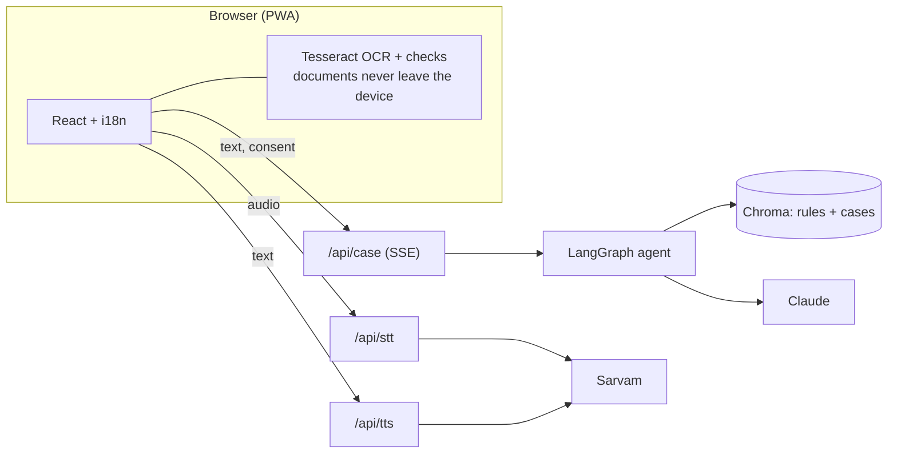

# Passport Mitra

**Check before you book. Fix it when you're stuck.**

Passport and visa paperwork help for India. Voice-first, regional-language, privacy-first. Built for GDG DevFest 2026.

- **Document Cart (M1):** photograph your documents, read them on the phone (nothing is uploaded), catch name/DOB/address mismatches before you book.
- **Stuck-Case Solver (M2):** describe your problem in any supported language. A LangGraph agent finds the official rules and similar cases, flags where sources disagree, and answers with citations and a confidence level.
- **Status Decoder (M3), Voice (M4), Assisted Mode (M5)** for cyber cafés and CSC operators.

The full plan (problem, evidence, architecture, data, hour-by-hour build) is in [docs/implementation.md](docs/implementation.md). This README covers how to run and split the code.

---

## Quick start

Prerequisites: [uv](https://docs.astral.sh/uv/) (installs Python 3.12 for you) and Node 20.19+ (or 22.12+).

```bash
make setup
```

```bash
make ingest
```

```bash
make dev
```

| What | Where |
|---|---|
| Web app | http://localhost:5173 |
| API + interactive docs | http://localhost:8000/docs |

Port 8000 busy? Run `make dev API_PORT=8010` instead. `make ingest` downloads the embedding model (~500 MB) the first time. Run it again after any change in `backend/data/rules` or `backend/data/cases`. `make help` lists every command.

**No keys needed to start.** The agent picks its model automatically (`LLM_PROVIDER=auto`): Claude if `ANTHROPIC_API_KEY` is set, else **Gemini** if `GEMINI_API_KEY` is set (free key from aistudio.google.com, rate limited to about 8 requests/minute by `GEMINI_RPM`), else a **local Ollama model** (`ollama pull qwen2.5:3b`, free and offline but slower and weaker, the UI shows a banner), else a sample answer ("Demo mode"). Without `SARVAM_API_KEY` the speech endpoints return 503 and the app uses the browser's own speech. Add keys to `.env` when you have them.

Before you push, run:

```bash
make check
```

CI runs the same checks on every PR.

---

## Repository layout

```
├─ docs/implementation.md        The plan. Section numbers below refer to it.
├─ backend/                      Python 3.12, FastAPI, LangGraph (uv project)
│  ├─ app/
│  │  ├─ main.py                 FastAPI app; mounts routers under /api
│  │  ├─ schemas.py              ★ API contract (mirrored in frontend/src/lib/types.ts)
│  │  ├─ config.py               Settings from .env
│  │  ├─ llm.py                  The only place that calls Claude: structured(Schema, ...)
│  │  ├─ rag.py                  Chroma + multilingual-e5 embeddings
│  │  ├─ corpus.py               Loads and validates rules/*.md and cases/*.json
│  │  ├─ pii.py                  Redacts Aadhaar/PAN/passport/phone/email from user text
│  │  ├─ speech.py               Sarvam STT, TTS, translate
│  │  ├─ glossary.py, status.py  Locked translations; status decoder
│  │  ├─ translation.py          localize_answer(): the agent's only link to translation
│  │  ├─ agent/
│  │  │  ├─ graph.py             LangGraph wiring and routing rules
│  │  │  ├─ state.py             CaseState
│  │  │  ├─ prompts.py           System prompts
│  │  │  └─ nodes/               One file per node: intake, triage, clarify, retrieve, ...
│  │  └─ routers/                health, case (SSE), speech, status
│  ├─ data/
│  │  ├─ rules/*.md              Official rules (YAML front matter + text). See _TEMPLATE.md
│  │  ├─ cases/*.json            Case cards. See _TEMPLATE.json
│  │  ├─ glossary.json, status_map.json, eval_cases.json
│  │  ├─ reference/              Sourced figures from the plan: PV backlog by state, national stats, e-Visa rules
│  │  └─ fixtures/mock_answer.json  What mock mode returns
│  ├─ scripts/ingest.py, query.py
│  └─ tests/
├─ frontend/                     Vite, React 19, TypeScript, Tailwind 4, i18next, PWA
│  └─ src/
│     ├─ lib/                    api.ts (typed client), types.ts ★, sse.ts, speech.ts, langs.ts, reference.ts
│     ├─ i18n/<lang>/{app,cart,stuck,status}.json   one file per area, so lanes never collide
│     ├─ store/                  App state (zustand) and the assisted-mode reset registry
│     ├─ components/             Layout, BigButton, MicButton, ListenButton, ConfidenceBadge
│     └─ features/
│        ├─ onboarding/          Language picker + spoken privacy promise + consent
│        ├─ home/
│        ├─ cart/                M1: ocr.ts, extract.ts, checks.ts, types.ts, store.ts, CartPage
│        ├─ stuck/               M2: StuckPage (chat), AnswerCard
│        ├─ status/              M3
│        └─ assisted/            M5
├─ .env.example                  Every setting, with defaults
├─ Makefile                      setup, dev, ingest, query, test, lint, check
└─ .github/workflows/ci.yml
```

---

## How it fits together



**Agent graph** (`backend/app/agent/graph.py`, plan 3.4, both retrievers in one node):

```
intake → triage ─┬─ clarify (asks ONE question, pauses) → triage   max 2 rounds
                 └─ retrieve ─┬─ live_search (low confidence + enabled) ─┐
                              └──────────────────────────────────────────┴─ verify → synthesize
→ action_draft → guardrail ─┬─ synthesize (one regenerate)
                            └─ localize → END
```

### API contract

`backend/app/schemas.py` is the source of truth and `frontend/src/lib/types.ts` mirrors it. **If you change one, change the other in the same PR.**

| Endpoint | Body | Returns |
|---|---|---|
| `GET /api/health` | | `{ok, llm: "live"\|"mock", sarvam, index_ready}` |
| `POST /api/case` | `{thread_id?, lang, text, cart_issues?, consent, search_enabled?}` | SSE stream (below) |
| `POST /api/case/resume` | `{thread_id, text}` | SSE stream; 404 if nothing is pending |
| `POST /api/stt` | multipart `audio`, `lang_hint?` | `{text, lang}`; 503 means use the browser |
| `POST /api/tts` | `{text, lang}` | `audio/wav`; 503 means use the browser |
| `POST /api/translate` | `{text, target_lang}` | `{text}`; 503 if Sarvam is off |
| `POST /api/status/decode` | `{text}` | `{matched, meaning, next_step, source}` |

SSE events: `progress {node}` once per finished node, then exactly one of `clarify {thread_id, question}`, `result CaseResult` or `error {code, message}`. `lang` is one of `en hi ta mr bn`.

---

## Workstreams (team of four)

**[TEAM.md](TEAM.md) is the source of truth:** who owns which files, task lists, the interfaces between lanes, the timeline and the Git workflow. Edit only your lane's files.

| Lane | Tag in code |
|---|---|
| A. Agent & API | `TODO(agent)` |
| B. Document Cart | `TODO(cart)` |
| C. App & UI | `TODO(frontend)` |
| D. Knowledge, language & eval | `TODO(voice)` |

### What already works and what's stubbed

| Area | Working now | Stubbed (owner) |
|---|---|---|
| API | All endpoints, SSE streaming, consent check, PII scrub, input caps, CORS, **rate limiting** (per IP and thread, 429), **run timeout** | Rate limits are per process (fine for a demo) |
| Agent | Whole graph runs end to end. **Unsafe requests are refused deterministically** (no model involved); triage, retrieve, **verify** (checks remedies against official rules, surfaces source conflicts), synthesize, **action_draft** (affidavit and RPO-letter templates), **guardrail** (citations must exist, no outcome promises, confidence capped by evidence, one regenerate then abstain); fixed Journey B clarify question in 5 languages. Models: Claude or Gemini when keyed, local Qwen2.5-3B otherwise. **Verified live on Gemini (EN, HI, TA, unsafe, Journey B) and on local Qwen; the Claude path is unit-tested but has not run with a key.** Resilience: 5xx retries, fallback model, automatic fallback to the local model if the network drops. `make smoke` re-runs the live check | First Claude run and prompt tuning (A); `live_search` (A, stretch); native-speaker review of translations and disclaimers (D) |
| Localization | `translation.localize_answer`: the model translates, then citations, dates, confidence and the disclaimer are restored from the English original (the disclaimer uses fixed per-language wording). Rejects untranslated output and changed list structure. Drafts stay in English | Native-speaker review of glossary, disclaimers, hi/ta/mr/bn UI strings (D) |
| Retrieval | Ingest, multilingual embeddings, Chroma, merged queries, relevance cutoff, official and reliability and recency weighting, wrong-domain exclusion (e-Visa vs passport), calibrated confidence | Re-measure `MIN_RELEVANCE` if the corpus grows a lot (checked against the 63-chunk corpus: 12 of 12 relevant probes answered, 3 of 4 irrelevant ones correctly returned nothing) (A) |
| Speech | Sarvam STT/TTS/translate wrappers, browser fallbacks, mic and listen buttons | Live Sarvam test with a key (D); voice UX on phones (C) |
| Cart | Photo → on-device OCR (lazy language data) → Aadhaar masked → raw text | Preprocessing, classify, extract, confirm/edit screen, checks, result card (B) |
| UI | Language + consent, home, chat with progress and clarify, answer card, status decoder, assisted counter + clear-all, PWA | Journey timeline, PV chip, share as image (C); translations (D) |
| Data | 1 rule file (e-Visa), 1 case card, glossary seed, 2 status patterns, 2 unsafe eval prompts, all reference figures | The data sprint (D) |

---

## Rules we don't break

> **Privacy note on Gemini's free tier:** Google's free API tier may use prompts to improve its products (confirm in their terms). We strip ID numbers before anything is sent, but users' problem descriptions would go to Google. Use Claude (paid) or the local model for anything beyond a demo, and don't claim stronger privacy than that on screen.

From the plan (sections 6 and 7.3). Never cut these:

1. **The confirm/edit screen** before any document check runs.
2. **Citations, the confidence badge and the disclaimer** on every answer.
3. **Aadhaar masking.** Mask on extraction (`maskAadhaar` in `cart/extract.ts`), keep only the last 4 digits.
4. **Documents stay on the device.** Only user text (scrubbed by `pii.scrub`) and mismatch *types* go to the server.
5. **No user text or document values in logs.** Log node names, latency and error types only.
6. **Never promise outcomes.** "Commonly causes problems", never "will be rejected". Drafts are templates with `[____]` blanks.

---

## Corrections to the plan found during setup

- **Claude model IDs:** `claude-haiku-5-5` does not exist. The fast model is `claude-haiku-4-5`. Main stays `claude-sonnet-5-5`. Both are set in `.env`.
- **Sarvam TTS voice:** `meera` is not a Bulbul voice in the current SDK. We use Sarvam's default voice unless you set `SARVAM_TTS_SPEAKER`.
- **Sarvam TTS languages** (open item in plan 11): Bengali, English, Gujarati, Hindi, Kannada, Malayalam, Marathi, Odia, Punjabi, Tamil and Telugu. That covers all five of our languages.
- **Retrieval confidence:** multilingual-e5 similarity scores bunch up high. Unrelated chunks still score about 0.77, so the plan's 0.5 "low confidence" threshold will never trigger. Calibrate `LOW_CONFIDENCE` in `graph.py` using `make query`.
- **PV backlog table** (plan 4.2) was checked: the 36 state rows add up exactly to the stated 277,929.
- **Date-of-birth rule** (plan 3.3 and 11): "birth certificate if born on or after 26 Jan 1989" was outdated. Lane D verified the current rule from the official portal (`data/rules/dob-proof.md`): a birth certificate is required only for people born on or after **1 Oct 2023**; Aadhaar is **not** an accepted date-of-birth proof. The Document Cart reads the cutoff from that rule; see `TEAM.md`.
- **A/B/C counters** (plan 3.5 and 11): described the same way by several secondary sources, but the official PDF is image-only and has not been read. Treat as unverified.
- **Document-check "standard":** the government publishes which documents are required and valid, not how strictly names must match. The plan's 0.85 fuzzy-match threshold and the name-match tiers are our own judgment. See `TEAM.md`.
- **Gemini model ids:** `gemini-2.5-flash` appears in the model list but returns 404 for new keys. Verified with a real key: `gemini-3.8-flash` for answers, `gemini-3.1-flash-lite` for triage. Thinking level LOW halves answer latency with the same quality.
- **Gemini free-tier quota is tiny and per model:** `gemini-3.8-flash` allowed only **20 requests per day** (measured; one case uses 2-3 calls) and was used up by one afternoon of testing. So `llm.py` keeps an ordered chain of models (`GEMINI_MODELS_MAIN/FAST`), skips a model the moment its daily quota is spent, moves on at once when a model is overloaded or slow (we saw a 41 s hang then 503), and caches identical calls in memory. If every Gemini model is spent it uses the local model, then the sample answer. **Do not share one key across the team**: use the local model or mock for development, and keep the Gemini key for integration and the demo. Running `make smoke` costs about 15 calls.

---

## Deploying

- **Backend:** `backend/Dockerfile` (Cloud Run, Render or Railway). It bakes the model and index into the image. Set the same env vars as `.env`, and add the frontend's URL to `ALLOWED_ORIGINS`. *Not yet test-built.*
- **Frontend:** `npm run build` in `frontend/` → static `dist/`. Set `VITE_API_BASE` to the backend URL at build time. `vercel.json` handles SPA routes on Vercel.
- **Demo fallback:** `MOCK_LLM=true` serves the sample answer with no network calls to Claude.
